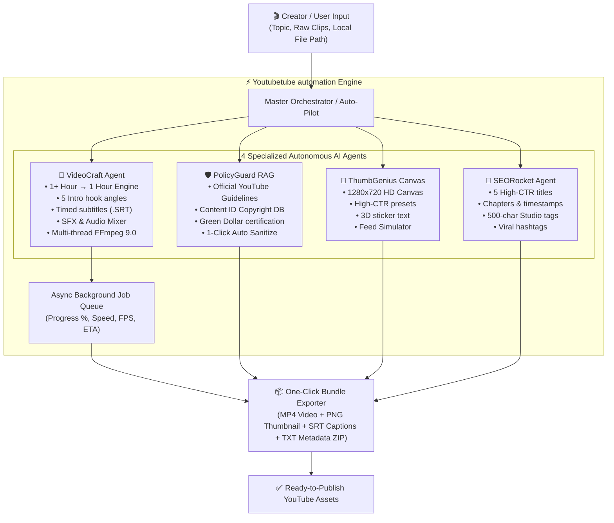
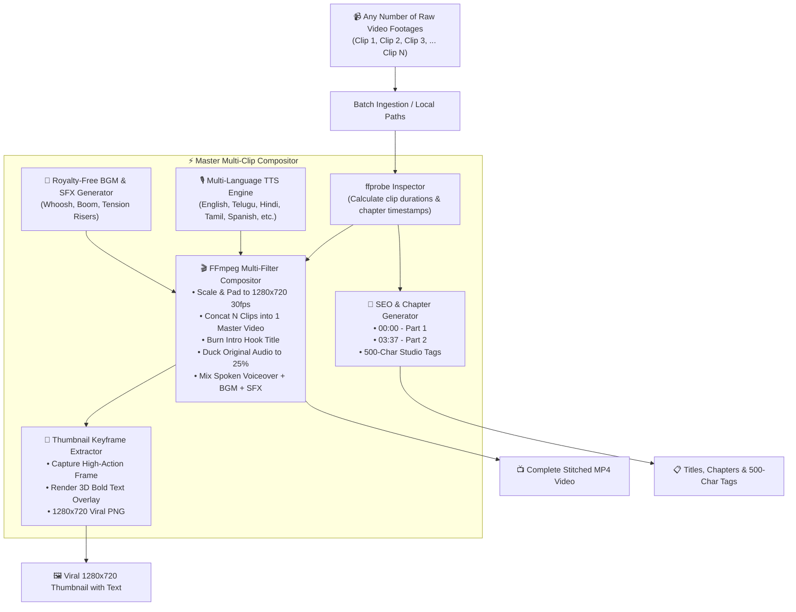
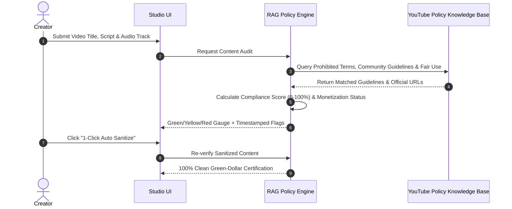

# 🚀 Youtubetube automation

> **All-in-one autonomous YouTube studio combining specialized AI agents into a single, intuitive, high-performance web application.**

Developed for **P V Harish Chandran** ([@harishcpv](https://github.com/harishcpv) • harishcpv123@gmail.com).

---

### 🕉️ NEW: 100% Free Autonomous Hindi Media Pipeline
> **Transform raw Hindi mythological and Panchatantra story scripts into finished YouTube Long-Form (16:9) and Shorts (9:16) videos with zero manual intervention.**
- **Character Consistency:** Locked Master Character Reference Image with seed binding across all scenes.
- **Natural Voice:** Neural Hindi narration (`hi-IN-MadhurNeural`, `hi-IN-SwaraNeural`) with emotional prosody & ducked Indian Tanpura drone.
- **Auto Subtitles:** Local Whisper STT + Devanagari `.srt` generation burned via FFmpeg.
- **Dual-Format Output:** 1920x1080 (16:9) and 1080x1920 (9:16) renders.
- **Quickstart:** `python pipeline.py --demo` or `python pipeline.py --script sample_panchatantra.txt`
- Detailed documentation: [**`README_PIPELINE.md`**](./README_PIPELINE.md)

---

## 🏗️ System Architecture & Multi-Agent Flow



---

## 🎬 Multi-Clip Batch Auto-Stitcher Pipeline (Any Number of Clips)

Upload **any number of raw video footages** (1, 2, 3, 4, 8, 15+ clips, no limit). The master automation engine automatically:
1. **Normalizes & Stitches** all raw takes into one seamless sequence in your customized order (handling any resolution and duration up to 1 hour).
2. **Re-Order Clips**: Interactive ⬆️ and ⬇️ sequencing controls to arrange your footage story in exact order.
3. **Injects Intro Hook** with attention-grabbing animated yellow/black text overlay in the first 4 seconds.
4. **Generates Native AI Voiceover** in your chosen language (English, Telugu, Hindi, Tamil, Spanish, German, Japanese, etc.).
5. **Layers Royalty-Free Background Music & SFX** with automated audio ducking (lowers clip audio to 25% under the voiceover).
6. **Burns Timed Multilingual Subtitles (.SRT)** synchronized with the narration.
7. **Renders 1280x720 Viral Thumbnail** with 3D text overlay on the video's best keyframe.
8. **Generates Complete SEO Package** (viral titles, descriptions with chapter timestamps for each clip, and 500-char tags).



---

## ⏱️ 1-Hour Long-Form Video Pipeline

Specifically engineered to take **more than 1 hour of raw footage** (podcasts, streams, raw tutorials, multicam recordings) or shorter clips, and edit it down into an exact **1-hour (3,600s)** YouTube video or exact clip duration.

```mermaid
flowchart LR
    RawInput["📹 1.5h - 4h+ Raw Video\n(MP4, MOV, MKV, WebM)"] --> Ingestion{"Ingestion Mode"}
    
    Ingestion -->|"Option A (Fastest)"| LocalPath["Direct Local Path\n(Bypasses Browser Upload for 10GB+ Files)"]
    Ingestion -->|"Option B"| BrowserUpload["Browser File Upload"]
    
    LocalPath --> Probe["🔍 ffprobe Deep Inspector\n(Duration, Resolution, FPS, Bitrate)"]
    BrowserUpload --> Probe
    
    Probe --> SilenceDetect["🔇 silencedetect Engine\n(Finds & Trims Dead Air / Pauses)"]
    SilenceDetect --> TargetCut["🎯 Target Duration Compressor\n(Strict 60:00 / 3,600s Cut)"]
    TargetCut --> HookBurn["🔥 Intro Hook Overlay\n(First 5s Visual Hook)"]
    HookBurn --> FFmpegRender["⚙️ Multi-Thread FFmpeg (-threads 0)\n(Real-Time Speed, FPS, ETA Monitor)"]
    FFmpegRender --> OutputMP4["📺 Rendered 1-Hour MP4\n(Ready for YouTube Upload)"]
```



---

## 🛡️ Policy & Copyright RAG Guardian Workflow



---

## 🌟 The 4 Core Autonomous Agents

### 1. 🎥 Video Production & Editing Agent (`VideoCraft AI`)
- **1-Hour Long-Form Editing Engine**: Compress 1.5 to 4+ hours of raw recording down to an exact 1-hour (3,600s) polished YouTube video.
- **Local File Path Ingestion**: Paste direct local file paths (e.g., `C:\Videos\Podcast_1h40m.mp4`) to bypass slow browser uploads for giant 10GB–25GB raw recordings.
- **Smart Silence & Dead-Air Removal**: Uses FFmpeg's `silencedetect` audio filter to cut awkward pauses and dead air, boosting audience retention.
- **Intro Hook Generator**: 5 psychological intro angles (*Pattern Interrupt, Curiosity Loop, Extreme Stakes, Counter-Intuitive Truth, Number Hook*) with retention potential ratings.
- **Timed Subtitles & Captions**: Hormozi-style yellow box, MrBeast punch, and clean modern caption formats with word-level timing and automatic `.SRT` export.
- **Sound Effects (SFX) Mixer**: Pristine 16-bit uncompressed audio synthesis for Whoosh, Ding, Pop, Cinematic Boom, and Tension Risers with inline auditioning.
- **Hardware Acceleration**: Multi-threaded execution (`-threads 0 -preset veryfast`) for both 16:9 Landscape (1080p) and 9:16 Vertical Shorts.

### 2. 🛡️ Policy & Copyright RAG Agent (`PolicyGuard RAG`)
- **Knowledge Base**: Curated database of official YouTube Community Guidelines, Fair Use doctrine, Content ID audio rules, and AdSense advertiser-friendly standards.
- **Instant Compliance Audit**: Scans title, script, description, and music tracks.
- **Monetization Status Gauge**: Live Green Dollar (Full AdSense), Yellow Dollar (Limited Ads), or Red Strike warnings.
- **Remediation & 1-Click Auto Sanitize**: Identifies exact timestamps, quotes violating phrases, cites official `support.google.com/youtube` documentation, and sanitizes scripts with 1 click.
- **Interactive Policy Explorer**: Semantic search query to ask policy questions directly.

### 3. 🎨 Viral Thumbnail Studio (`ThumbGenius AI`)
- **HTML5 Canvas Editor (1280x720 HD)**: Full standard YouTube thumbnail rendering.
- **High-CTR Visual Presets**: MrBeast contrast split (Cyan/Red), Vox dark documentary slate, and Extreme Versus styles.
- **Bold 3D Text Overlays**: Multi-color fills (Neon Yellow, Green, Red, White), thick black sticker strokes, 3D drop shadows, and font sizing.
- **Viral Attention Badges**: Red arrows ↗️, shock emojis 😱, 100% Free badges 🏷️, and warning signs ⚠️.
- **Live YouTube Feed Simulator**: Preview your thumbnail in a simulated YouTube desktop/mobile homepage to test clickability against competing videos.
- **1-Click Export**: Instant 1280x720 PNG download under the YouTube 2MB threshold.

### 4. 🚀 SEO & Metadata Agent (`SEORocket AI`)
- **5 High-CTR Titles**: Categorized by psychological angles with predicted CTR ratings (e.g., 11.8%) and mobile-friendly character counters.
- **SEO Description with Chapters**: High-conversion first two lines, value bullets, and automatic timestamp chapters (`00:00`, `00:45`, `01:30`).
- **500-Character YouTube Studio Tags**: Pre-formatted with commas for direct paste into YouTube Studio.
- **Viral Hashtags**: Formatted `#Shorts`, `#Trending`, and niche hashtags.

---

## ⚡ 1-Click Master Auto-Pilot Pipeline
Input a single video topic or prompt (e.g. *"5 Mind-Blowing AI Tools That Feel Illegal in 2026"*), and watch all 4 agents coordinate sequentially to deliver the entire production package in seconds.

---

## 🚀 Quick Start Guide

### Prerequisites
- Node.js (v18+ or v24+)
- FFmpeg (v6+ or v9+) installed and on PATH

### 1. Launch the Server
```bash
# In project root
node backend/server.js
```
The full application will be live at:
```
http://localhost:5000
```

### 2. Run in Development Mode (Vite Hot-Reload)
```bash
# In /client directory
npm run dev
```
Accessible at `http://localhost:3000` (auto-proxies all API requests to port 5000).

---

## 📦 One-Click Bundle Export
Click **"Export Bundle"** in the top navbar to download a consolidated `.zip` containing:
- `video.mp4` (Full rendered video with intro hook and subtitles)
- `thumbnail.png` (High-CTR 1280x720 thumbnail)
- `captions.srt` (Standard subtitle file)
- `youtube_metadata.txt` (Title, description, chapters, tags ready for YouTube Studio)

---

## 👤 Author
- **P V Harish Chandran**
- GitHub: [@harishcpv](https://github.com/harishcpv)
- Email: [harishcpv123@gmail.com](mailto:harishcpv123@gmail.com)
