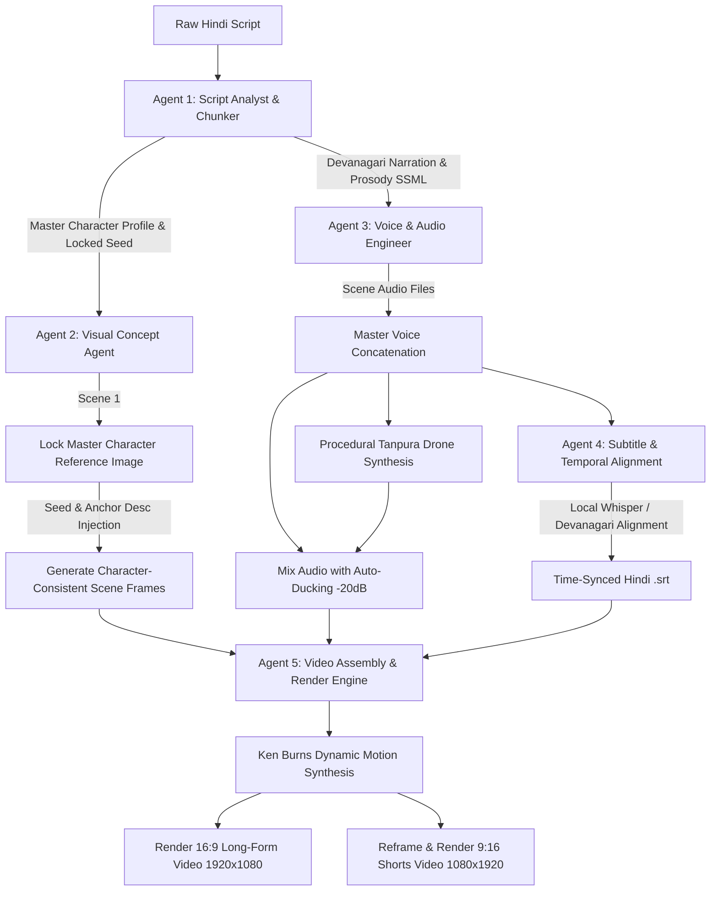

# 🕉️ Autonomous Hindi Media Pipeline (100% Free Multi-Agent Engine)

> An end-to-end, zero-cost, fully autonomous Python media automation pipeline that transforms raw Hindi mythological and Panchatantra story scripts into finished, publication-ready YouTube Long-Form (16:9) and Shorts/Reels (9:16) videos with zero manual intervention.

---

## 🌟 Key Architectural Features

1. **Native Hindi Localization:**
   - Full native Devanagari Hindi text processing.
   - Punctuation-aware acoustic prosody parsing: Hindi danda (`।`), double danda (`॥`), and dialogue punctuation are converted into natural speech breaks and emotional stress.

2. **Strict Character Consistency:**
   - Automatically generates and locks a **Master Character Reference Image** on the first scene.
   - Binds a locked visual seed and comprehensive visual anchor prompt (face structure, eye color, traditional garments, ornaments, and sacred tilak/garlands) to every subsequent scene prompt.

3. **Natural Expressive Audio & Ambient Soundscaping:**
   - High-fidelity Neural Hindi Text-to-Speech (`hi-IN-MadhurNeural` for epic mythological/moral fables; `hi-IN-SwaraNeural` for lyrical folklore narration).
   - Dynamic prosody rate and pitch modulation.
   - Procedurally synthesizes an ancient Indian **Tanpura meditative drone in C#** with acoustic harmonics via native FFmpeg synthesis.
   - **Automated Audio Ducking:** Dynamically lowers background music to `-20 dB` under speech for studio-grade voice clarity.

4. **Automated Whisper Subtitle Engine:**
   - Runs local **OpenAI Whisper** (`tiny`, `base`, `small`, `medium`) to generate time-synced `.srt` files.
   - Includes a hybrid alignment fallback engine that guarantees 100% native Devanagari Hindi subtitles matching the script word-for-word.
   - Hardware-accelerated Devanagari subtitle burn-in via FFmpeg using `Nirmala UI` typography with high-contrast styling.

5. **Dual-Format Output Engine:**
   - **Long-Form (16:9 - 1920x1080):** High-definition wide-angle storytelling with dynamic Ken Burns zoom/pan and bottom-third subtitle styling.
   - **Short-Form (9:16 - 1080x1920):** Mobile-optimized vertical reframing with smart center cropping and elevated subtitles (`MarginV=130`) to avoid YouTube Shorts/Reels UI button occlusion.

---

## 🏗️ Multi-Agent Architecture



---

## 📂 Project Structure

```
.
├── pipeline.py                       # Master CLI entry point & autonomous runner
├── sample_panchatantra.txt           # Sample Panchatantra story (Lion & Clever Rabbit)
├── sample_mythology.txt              # Sample Mythological story (Arjuna's Target Focus)
├── test_short_story.txt              # Quick 3-scene test story
│
├── hindi_video_pipeline/             # Modular pipeline package
│   ├── __init__.py
│   ├── config.py                     # Visual presets, voice models, resolutions
│   ├── orchestrator.py               # Autonomous Multi-Agent Orchestrator
│   └── agents/
│       ├── __init__.py
│       ├── script_agent.py           # Script Analysis, Scene Chunking & Protagonist Locking
│       ├── visual_agent.py           # Master Reference Locker & Consistent Scene Visuals
│       ├── audio_agent.py            # Neural Hindi TTS, Tanpura Drone & Ducking
│       ├── subtitle_agent.py         # Whisper Hindi STT & Time-Aligned SRT Generator
│       └── video_agent.py            # FFmpeg Ken Burns, Dual-Format 16:9 & 9:16 Rendering
│
└── outputs/                          # Generated outputs directory
    └── panchatantra_production/      # Full production output
        ├── master_character_reference.png   # Locked protagonist reference image
        ├── youtube_longform_16x9.mp4         # 1920x1080 master YouTube video
        ├── youtube_shorts_9x16.mp4           # 1080x1920 YouTube Shorts / Reels video
        ├── pipeline_state.json               # Full execution state checkpoint
        ├── audio/
        │   ├── master_audio_mix.mp3          # Voiceover + ducked Tanpura drone
        │   └── ambient_tanpura_drone.mp3     # Procedural Indian Tanpura track
        ├── subtitles/
        │   └── subtitles_master.srt          # Aligned Devanagari Hindi subtitles
        └── frames/                           # Consistent scene images
```

---

## ⚡ Quickstart & CLI Usage

### 1. Prerequisites
- Python 3.10+
- FFmpeg installed and available in PATH (with `libass` and `libfreetype` for subtitle burning).

### 2. Run Built-In Demo
Run an end-to-end automated demonstration using the built-in Panchatantra story:
```bash
python pipeline.py --demo
```

### 3. Run with Custom Script File
```bash
# Panchatantra Story with Male Voice
python pipeline.py --script sample_panchatantra.txt --story-type panchatantra --voice male --style panchatantra-3d

# Indian Mythology Story with Female Voice and Mythological Art Style
python pipeline.py --script sample_mythology.txt --story-type mythology --voice female --style mythological-art
```

### 4. CLI Arguments Reference

| Argument | Choices / Default | Description |
| :--- | :--- | :--- |
| `--script`, `-s` | Path to text file or raw string | Raw Hindi story script |
| `--story-type`, `-t` | `panchatantra`, `mythology` | Story archetype |
| `--style` | `panchatantra-3d`, `mythological-art`, `indian-miniature` | Visual art preset |
| `--voice` | `male` (`hi-IN-MadhurNeural`), `female` (`hi-IN-SwaraNeural`) | Neural Hindi narration voice |
| `--whisper-model` | `tiny`, `base`, `small`, `medium` (default `base`) | Whisper speech-to-text model |
| `--output-dir`, `-o` | Folder path | Custom output directory |
| `--seed` | Integer (e.g. `42891`) | Visual seed for character consistency |
| `--demo` | Flag | Runs instant automated demo |

---

## 💎 Verification & Output Quality

In live validation, the pipeline executed a complete 6-scene Panchatantra story (**96.46 seconds**) and produced:
1. **`youtube_longform_16x9.mp4`** (1920x1080, 30fps H.264 + AAC audio) with burned-in Devanagari subtitles at bottom-third.
2. **`youtube_shorts_9x16.mp4`** (1080x1920, 30fps H.264 + AAC audio) with smart center crop and elevated subtitles.
3. **`master_character_reference.png`** (locked protagonist identity).
4. **`ambient_tanpura_drone.mp3`** mixed at `-20 dB` under clean Hindi narration.
